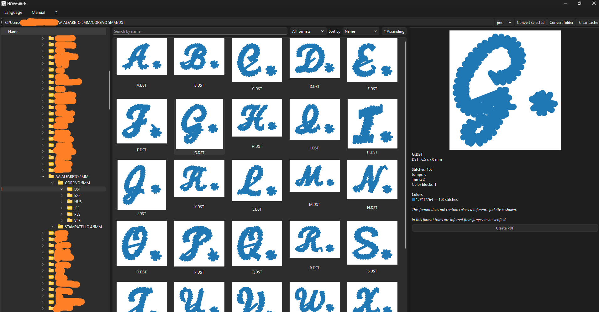
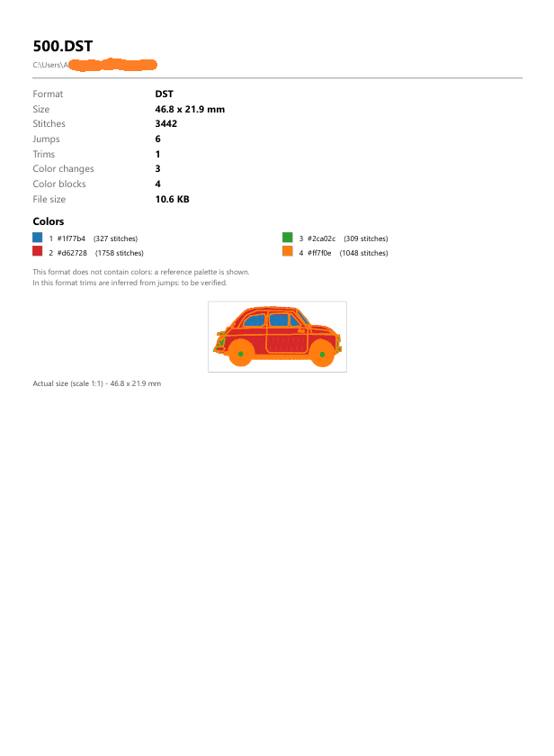

# NOVAstitch
Novastitch is an embroidery file manager (with thumbnails, colour prewiew and .pdf generator), converter and batch converter.  it's made for be easy to install on win and mac and to be easy to use by non technical users.

It's based on a file manager + pyembroidery

